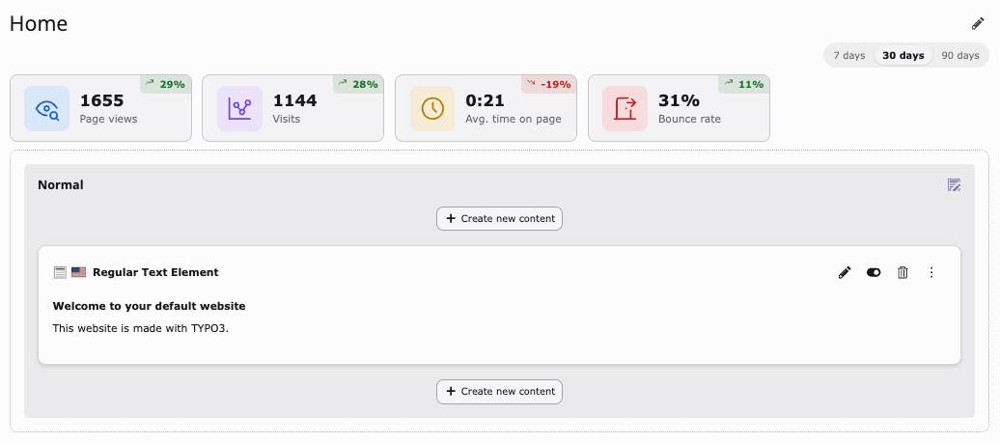

<div align="center">


# TYPO3 extension `typo3_page_metrics`

[](https://github.com/konradmichalik/typo3-page-metrics/actions/workflows/ci.yml)
[](https://github.com/konradmichalik/typo3-page-metrics/actions/workflows/ci.yml)
[](LICENSE.md)
[](https://extensions.typo3.org/extension/typo3_page_metrics)

</div>

Page-level metrics inside the TYPO3 backend, from an analytics provider you
already run.

No tracking code, no third-party service, no subscription: the extension reads
your existing Matomo or GA4 data — or your web server's own access log,
without any analytics service at all — and resolves every URL it reports —
through redirect chains and multilingual slugs — back to a TYPO3 page UID,
then stores per-page daily aggregates so editors can see "how is this page
doing" without leaving the backend.



## ✨ Features

- URL → page UID resolution at import time, through redirect chains and
  multilingual slugs, so every number hangs off a page in the tree rather than
  a URL string: tiles link straight into the page module, a section can roll
  its whole subtree up into one figure, and URLs that resolve to no page are
  reported as [Not found pages](docs/dashboard-widgets.md)
- Metric tiles right in `Web > Page`, below the page title: page views,
  visits, avg. time on page, bounce rate, a period switch (7/30/90 days),
  and a sparkline popover per tile — see [Page module tiles](docs/page-tiles.md)
- Site-wide [EXT:dashboard](https://docs.typo3.org/permanent/typo3/cms-dashboard/main/en-us/)
  widgets plus a ready-made dashboard preset — see
  [Dashboard widgets](docs/dashboard-widgets.md)
- Annotations, derived from TYPO3's own record history (a page edited, a
  redirect created), imported (e.g. Matomo release markers) or created by
  hand, categorised, optionally spanning days or scoped to one page, and
  marked on every sparkline — see [Annotations](docs/page-tiles.md#annotations)
- Goal conversions per page, from Matomo goals or GA4 key events, as a tile
  of their own beside the traffic ones, with optional revenue — see
  [Goal tiles](docs/page-tiles.md#goal-tiles)
- Annotations, imported (e.g. Matomo release markers) or created by hand,
  categorised, optionally spanning days or scoped to one page, and marked on
  every sparkline — see [Annotations](docs/page-tiles.md#annotations)
- Matomo, GA4 and your own web server access log as pluggable providers,
  extensible with your own — see
  [Registering custom tiles](docs/extending.md)

## 🔥 Installation

### Requirements

- PHP 8.2, 8.3, 8.4 or 8.5
- TYPO3 13.4 or 14.0+
- A Matomo instance with API access, a GA4 property with a service-account
  key, and/or read access to your web server's own access log

### Composer setup

```bash
composer require konradmichalik/typo3-page-metrics
```

Then configure a provider for the site, see [Configuration](#configuration).

## ⚙️ Configuration

Add to a site's `config/sites/<identifier>/config.yaml`, under `pageMetrics`.
Each provider has its own settings and setup notes:

- [Matomo](docs/providers/matomo.md)
- [GA4](docs/providers/ga4.md)
- [Access log](docs/providers/accesslog.md)

Name a storage page under `pageMetrics.annotations.storagePid` and editors can
add their own markers straight from the page module, see
[Adding a marker](docs/page-tiles.md#adding-a-marker).

## ⚡ Usage

Run the import (also schedulable via the TYPO3 Scheduler). The same command
imports both metrics and any annotations from a registered provider (e.g.
Matomo release markers, see [Page module tiles](docs/page-tiles.md#annotations)):

```bash
vendor/bin/typo3 page-metrics:import
vendor/bin/typo3 page-metrics:import --force
```

Then open **Web → Page** and select a page in the page tree — the tiles
appear directly below the page title. See
[Page module tiles](docs/page-tiles.md) for the period switch, the subpages
toggle and the sparkline popover, or
[Dashboard widgets](docs/dashboard-widgets.md) for the site-wide EXT:dashboard
widgets.

## 📚 Documentation

| Page | What's inside |
| --- | --- |
| [Matomo provider](docs/providers/matomo.md) | Site configuration, `additionalHosts` for Dev/Stage instances |
| [GA4 provider](docs/providers/ga4.md) | Site configuration, the service-account key file, known GA4 caveats |
| [Access log provider](docs/providers/accesslog.md) | Site configuration, what it can and cannot measure, bot/asset filtering |
| [Dashboard widgets](docs/dashboard-widgets.md) | The full EXT:dashboard widget catalog, their settings and the bundled preset |
| [Page module tiles](docs/page-tiles.md) | The period switch, the subpages toggle, sparkline popovers and annotations |
| [Security](docs/security.md) | Restricting tile visibility per backend user group |
| [Registering custom tiles](docs/extending.md) | Contributing an additional tile via `ModifyMetricTilesEvent`, without implementing `MetricProviderInterface` |

## 🧭 Related extensions

`typo3_page_metrics` reads an analytics provider you already operate. It
tracks nothing itself and sends no data anywhere, which also means it can
only show what your provider already collects.

- [TYPO3 Analytics](https://analytics.typo3.com/) (`t3g/analytics`) is the
  opposite trade-off: a hosted analytics service by TYPO3 GmbH that registers
  your site, injects its own tracking script and shows the results in the
  backend. Pick it if you want analytics *and* the backend integration in one
  paid package, rather than a backend view onto an analytics setup you already
  run.
- [matomo_widgets](https://github.com/brotkrueml/typo3-matomo-widgets) puts
  Matomo's own reports on the TYPO3 dashboard, live via the Reporting API.
  Pick it if you want Matomo's reports as-is; it deliberately stays in Matomo's
  URL world and does not map anything onto the page tree.

## 🧑‍💻 Contributing

Please have a look at [`CONTRIBUTING.md`](CONTRIBUTING.md).

## 🏅 Credits

Tile icons are from [Tabler Icons](https://tabler.io/icons), MIT licensed.

## ⭐ License

GPL-2.0-or-later, see [`LICENSE.md`](LICENSE.md).
