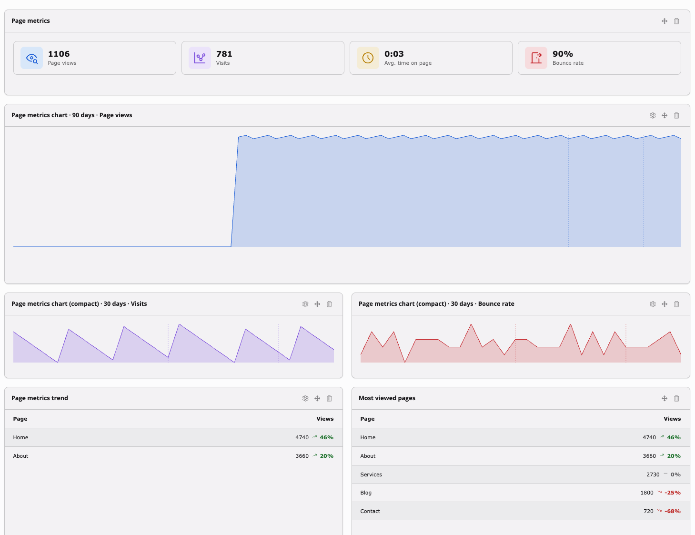

# Dashboard widgets

`typo3_page_metrics` registers a set of [EXT:dashboard](https://docs.typo3.org/permanent/typo3/cms-dashboard/main/en-us/)
widgets once that extension is installed, so page-level metrics are also
visible site-wide, without opening the page module. Registration is
conditional: on installations without EXT:dashboard, none of this loads (see
`Configuration/Services.php`).

Each widget lists every site that has a configured metric provider, and is
skipped entirely for sites without one.

| Widget | Identifier | Shows | Fixed period | Configurable |
| --- | --- | --- | --- | --- |
| Page metrics | `pageMetrics` | Each site's homepage tiles: page views, visits, avg. time on page, bounce rate | 7 days | — |
| Page metrics chart | `pageMetricsChart` | A daily chart of one metric per site, with annotation markers | — | Metric, period (7/30/90 days), marker category |
| Page metrics chart (compact) | `pageMetricsChartCompact` | The same chart, sized for compact dashboard layouts | — | Metric, period (7/30/90 days), marker category |
| Most viewed pages | `pageMetricsTopPages` | The highest-traffic pages per site, linked into the page module | 30 days | Page level, include subpages, goal column |
| Page metrics trend | `pageMetricsTrend` | Pages that improved or declined most against the previous period | 7/30/90 days | Metric, movement (declines/improvements), period |
| Not found pages | `pageMetricsNotFoundPages` | URLs the daily import could not resolve to a page, with the reason. A record detail URL served by a route enhancer resolves to the page that renders it and does not appear here; one below the same page that no record matches still does | 30 days | — |
| Page metrics annotations | `pageMetricsAnnotations` | Recent annotations with their kind and, for one that ran for a while, its last day | 90 days | — |

Every widget except the site-homepage tiles reads from the same
`SiteMetricsOverviewBuilder`, aggregated across all pages of a site rather
than a single one. That includes annotations: a dashboard covers the whole
site, so it shows every marker regardless of the page one may be scoped to
(see [Page scope](page-tiles.md#page-scope)).

The chart widget's **Marker category** setting narrows its markers to one
kind, for a dashboard that only wants to line releases up against the curve.
Left empty it shows all of them. Under the chart, a key names the categories
actually drawn rather than every category that exists.

## What changed

The **What changed** widget states the period's significant movements as
sentences rather than as figures, because the unit an editor acts on is a
sentence:

> Page views, 30 days: 1,655, up 29% against the previous period.
> Biggest riser by page views: "Services", up 46% to 2,610.

A site's **primary metric** is the first metric it counts: the one its
providers declare earliest that counts things rather than measuring a rate,
and that is not machine traffic. Every surface names the same one, so two
pages of a site are never charted against different metrics. A site that
declares only rates has no primary metric, and the surfaces that need one
treat it as they treat a site with no provider at all.

Four slots per site: the site's own movement on its primary metric, its most
significant other metric, the page that rose most and the page that fell most.
All sites' cards go into one ranked list and that list is cut to four, because
four cards spread over six sites is not four cards. Each card names its site
when the dashboard covers more than one.

Ranking a whole site's views against one page's percentage points needs a
number that means the same thing in both. It is how many times over its own
[significance threshold](#what-counts-as-a-movement) a movement went, which is
a bare multiple in every unit. Above that sits one rule: a site's own movement
is always listed before any of its pages', because a page that rose 46% inside
a site that rose 40% rose with the site, and a reader cannot tell that apart
from a page that rose on its own until the site's line has been read.

**An empty widget is a finding, not a fault.** Nothing significant moved, and a
widget that always finds something to say is one nobody believes. It is
deliberately harder to make this widget speak than the others: a site produces
no cards at all unless both the whole previous period and the current period up
to yesterday were imported. The other surfaces show a number and withhold a
badge; this one states a conclusion, and a scheduler that stopped a week ago
would otherwise have it publish a fall that never happened. A site with no
provider configured says that instead, rather than claiming nothing moved in
data nobody collected.

Machine traffic is left out entirely. How often a crawler fetched a page is a
true sentence and not one anybody opened a dashboard to read.

## Collapsed markers

With [automatic markers](page-tiles.md#automatic-markers) on, an active
editorial team produces a `content` marker per edited page per day. Ten pages
touched on a Tuesday would be ten ticks on the chart and ten rows in the
annotations widget, all saying the same thing.

Site-wide they are collapsed instead: the markers of one day and one kind
become a single marker that counts the pages and names the first three of
them, `14 pages updated (About, Home, Imprint and 11 more)`. It draws one
tick, takes one row, and its tooltip reads the same sentence.

Only a marker about exactly one page on exactly one day is collapsed. One
that covers a subtree or runs for several days keeps its own tick and its own
row, and so does an authored site-wide marker such as a release or a
campaign: counting those would lose what they were written to say.

Collapsing and the **Marker category** setting compose, because a day is
collapsed per kind. Narrowing a chart to `content` leaves that day's one
collapsed content marker, and narrowing it to `release` leaves the release
markers untouched.

The page module is not affected. There a marker belongs to the page in front
of you, and one marker a day on that page is the signal it was derived for
(see [Automatic markers](page-tiles.md#automatic-markers)).

## Data age

Every widget that shows imported numbers (tiles, chart, most viewed pages, trend) prints the day its data is from underneath, and marks it as stale once the import is more than two days behind. See [Data age](page-tiles.md#data-age) for what that date means and why it is normally not today.

Unlike the page module, a dashboard widget covers one site per row, so its date is that site's own provider's and never a compromise between several.

## Movement, not direction

The trend widget ranks by whether a page improved or declined, not by whether its number went up or down. The two only coincide for a metric where higher is better: a rising bounce rate is a decline, and a page whose bounce rate fell shows a green down arrow. Which way round a metric reads is set by its provider, see [Polarity](extending.md#polarity).

A metric with no polarity of its own, such as an average time on page, has no improvement to rank by, so for those the setting falls back to its literal direction meaning.

The widget's own icon beside the rows follows that same reading: it rises for a set of improvements and falls for a set of declines, whichever way the numbers behind them went. On a `LowerIsBetter` metric it therefore points the opposite way to the arrows in the rows underneath it, which carry the literal direction. Where the rows disagree, or where the metric has no better or worse at all, the icon drops back to a neutral shape rather than claiming one.

## What counts as a movement

A page going from 2 views to 4 has risen by 100%, and ranking on the percentage alone puts it above a page that lost a thousand. On any site with a long tail, which is every site, that inverts the answer a widget called "what moved" exists to give.

So a movement has to clear two thresholds rather than one, the pairing Matomo's Generated Insights plugin uses: a share of the previous period's value **and** a floor in the metric's own unit. Two views becoming four clears the share and not the floor; four thousand views becoming three thousand nine hundred and sixty clears the floor and not the share. Neither is reported. A page that went from twenty views to sixty clears both, and is reported, because a small page that genuinely tripled is news.

The floor is in the metric's own unit, so it is views for a count and percentage points for a rate. A bounce rate moving from 30% to 33% moved by 3, not by 10.

What survives is ordered by how far it moved, weighted by the traffic behind it, never by the percentage. For a rate the traffic behind it is the denominator: a bounce rate that swung forty points on five entries is not the same event as one that swung ten on two thousand, and the widget says so by putting the second one first.

Each provider sets these for its own metrics (see [Significance](extending.md#significance)); a metric that names none gets a tenth with no floor. The built-in figures are deliberately half of Matomo's, since a TYPO3 site is usually smaller than the Matomo Cloud volumes those were calibrated on. They may still be wrong for a particular installation.

An empty widget is therefore a real answer, not a fault: it says nothing moved far enough this period.

## Reading the chart

Each chart scales to its own data, so the shape of the curve says nothing about how big the numbers behind it are. The preset makes that concrete by putting two compact charts side by side: without a scale, a few dozen visits and a few thousand draw the same picture.

The chart therefore scales to the range its own data occupies rather than from zero, and names the first and last day underneath. What it shows is the shape of the period; the figures behind it are in the tiles and in the popover.

Those bounds come from the 5th and 95th percentile rather than the plain extremes, so one freak day cannot flatten every ordinary one into a sliver. A day outside that band is drawn clamped to the edge it exceeds, which keeps the chart readable at the cost of understating that one day. The figure itself is in the popover's peak, and in the chart's spoken summary.

Overlaying a second metric drops the area fill and leaves the two outlines, since two filled shapes would just muddy where they overlap. Each series keeps its own scale, so the legend is what tells them apart.

## Chart and trend metric selection

The chart and trend widgets' **Metric** setting both default to each
site's primary metric. Picking one explicitly is only meaningful for a
single-site widget instance: a multi-site widget falls back to each
site's own primary metric for any site whose provider doesn't support the
configured one.

## Most viewed pages: page level and subpages

By default "Most viewed pages" ranks every individual page across the
whole site. Setting **Page level** restricts the ranking to pages at an
exact depth below the site root (level 1 = the site's top-level sections,
level 2 = their children, and so on) instead. Combined with **Include
subpages**, each of those pages' own number becomes its own traffic plus
everything under it rolled up into one total — useful for seeing which
top-level section performs best as a whole, not just its own landing
page. "Include subpages" only has an effect once a page level is set.

## Most viewed pages: goal column

A page at the top of "Most viewed pages" is the busiest one, which is not
necessarily the one that earns anything. The **Goal column** setting adds a
second column beside the traffic, carrying one of the site's own configured
[goals](providers/matomo.md#goals) over the same period and for the same
pages, so a page with a tenth of the traffic and ten times the conversion
rate is visible as the more interesting row.

The setting lists the goals declared under `pageMetrics.goals`, by the label
the site gave them. A site that declared no goals is offered no setting at
all and keeps the widget exactly as it was, and a goal another site declared
is ignored for sites that did not: the column header is always the label of
the site it stands above.

The ranking stays on traffic. Ranking by conversions answers a different
question than "most viewed" asks, and a widget whose title says one thing
while its order says another is worse than two widgets. So the column
reports, it does not sort.

A page that converted nothing shows a zero rather than an empty cell. The
import writes no row for a page with no conversions (see
[Goals](providers/matomo.md#goals)), so the absence of a row is how "it did
not happen" is stored, and it is the same zero the page's own goal tile
shows in the page module. An empty cell would claim something else, namely
that nobody measured.

The column carries no percentage against the previous period. It states one
period's conversions beside one period's traffic, which is also why it never
has to withhold a comparison for a period the import did not cover, the way
the traffic column does (see [Data age](page-tiles.md#data-age)).

## Dashboard preset

A ready-made **Page Metrics** dashboard preset bundles every widget above. It
appears in the dashboard creation wizard once EXT:dashboard is installed, so
a new dashboard covering every site's metrics is one click away.

It opens with **What changed**, so the first thing on a new dashboard is a
sentence rather than a figure. Below the tiles and the large chart, it places two compact charts (Visits,
Bounce rate), then two trend widgets (Biggest improvements, Biggest
declines), then Most viewed pages and Not found pages, with the annotations
widget last.
The compact chart and trend widgets can each appear more than once with
different settings pre-configured, see
[Configuration/Backend/DashboardPresets.php](../Configuration/Backend/DashboardPresets.php).
