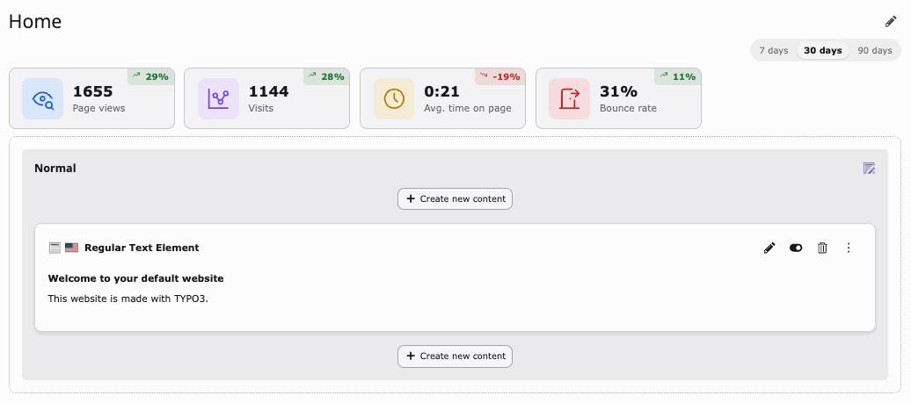
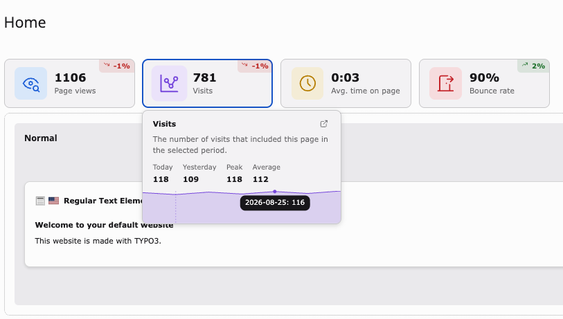

# Page module tiles

Opening **Web → Page** and selecting a page injects a lightweight placeholder
below the page title (via TYPO3 core's `ModifyPageLayoutContentEvent`, the
same extension point EXT:sys_note uses). Client-side JS then fetches the
actual tiles from `PageMetricsTilesController` right after the page has
loaded, so this never sits on the page module's own critical rendering path.

## Period switch

A `7 / 30 / 90 days` switch above the tiles controls the period every tile
and its sparkline cover. The active period is carried in the page module URL
(`tx_pagemetrics_period`), so it survives a reload or a bookmark.

## Including subpages

When the selected page has subpages, an options menu (`⋮`) appears next to
the period switch with a single **Include subpages** toggle. Turning it on
aggregates the tiles across the whole subtree instead of just the current
page, useful for a section landing page where the individual child pages
carry the actual traffic. The choice is carried in the URL
(`tx_pagemetrics_includeSubpages`) the same way the period is, and the
trigger button gets a small badge while the filter is active.

## Sparkline popover

Clicking (or focusing, via keyboard) a tile opens a popover with a
day-by-day sparkline for that metric over the selected period. Dashed
vertical markers on the sparkline mark any [annotation](#annotations) that
falls in the shown range; hovering or focusing a marker's date shows its
text in the tooltip alongside that day's value.

## Annotations

Annotations are site-wide, point-in-time events, imported by the same
`page-metrics:import` command via any registered
`AnnotationSourceInterface` (mirroring `MetricSourceInterface`'s
extensibility, but for events rather than per-URL metrics). The bundled
Matomo source imports Matomo's own annotations (e.g. release markers) —
no extra configuration beyond an already-configured `sources.matomo` is
needed.

Annotations show up in two places: the marker ticks on every sparkline
(page-tile popovers and the [dashboard chart widget](dashboard-widgets.md)
alike), and the dedicated
[annotations dashboard widget](dashboard-widgets.md).
